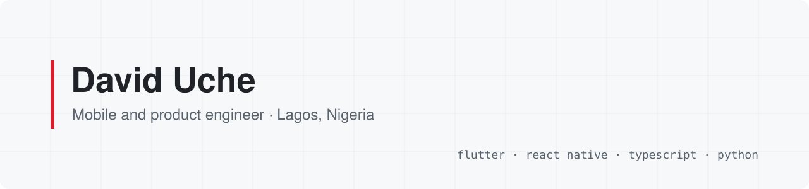

<picture>
  <source media="(prefers-color-scheme: dark)" srcset="banner-dark.svg" />
  
</picture>

I'm David (Acarson). I've been writing software for 7+ years, mostly mobile apps and the backends behind them. On most products I own the whole thing: the API, the database, payments, the app itself and the App Store release.

Right now I lead mobile at **Moneque**, a Naira fintech wallet. I also run **ACARSON LLC**, a small US company that ships my own products.

### What I'm working on

- **[Pingcharm](https://apps.apple.com/us/app/pingcharm-rizz-reply/id6759834337)** is an AI reply assistant on the App Store. The app is React Native (Expo). It includes a custom iOS keyboard, written in Swift, that reads the conversation with on-device OCR. The TypeScript API runs on Cloudflare Workers and falls back across several LLM providers.
- **Moneque** is a Flutter wallet for bank transfers, bills, virtual dollar cards, crypto and KYC. Money moves through a double-entry Postgres ledger with idempotency keys, so a retried transfer or a replayed webhook never posts twice.
- **RealtyConnect** is a property app built in Flutter, with a TypeScript API on Workers (D1, R2 and Queues). I built its "smart paste", which turns a messy WhatsApp listing into a typed form. On a set of held-out test messages, rules alone got the hardest field right 55% of the time; with an LLM pass added, it got all of them.
- **[MiniRec](https://minirecc.com)** recommends schools and courses. It runs on Next.js, Prisma, PostgreSQL and Redis workers, with Paystack and Stripe for billing.
- **Foldbooth** is a party camera app in Flutter with a native Swift camera plugin. It's in TestFlight now.

### Open source

- **[mirra](https://github.com/acarsondave/mirra)** downloads a website for offline browsing. It's a modern take on HTTrack that also copes with JavaScript apps and Cloudflare-protected sites.
- **[appstore-checklist](https://github.com/acarsondave/appstore-checklist)** is the list I go through before submitting to App Review, written up from rejections I've had.
- **[daily-fret](https://github.com/acarsondave/daily-fret)** tracks guitar practice.

Most of my day-to-day work happens in private repos, so the contribution graph is busier than the public repo list.

### Stack

**Mobile:** Flutter, Dart (Riverpod), React Native (Expo), Swift 
**Backend:** TypeScript, Node.js, Python (FastAPI), Cloudflare Workers, PostgreSQL, Redis 
**Shipping:** GitHub Actions, Xcode Cloud, TestFlight, RevenueCat, Mixpanel, Crashlytics

### Contact

[LinkedIn](https://linkedin.com/in/uche-chimdindu-david) · acarsondev@gmail.com

<picture>
  <source media="(prefers-color-scheme: dark)" srcset="https://raw.githubusercontent.com/acarsondave/acarsondave/output/github-snake-dark.svg" />
  
</picture>
