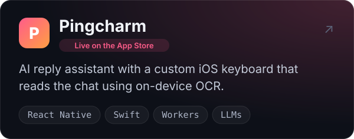
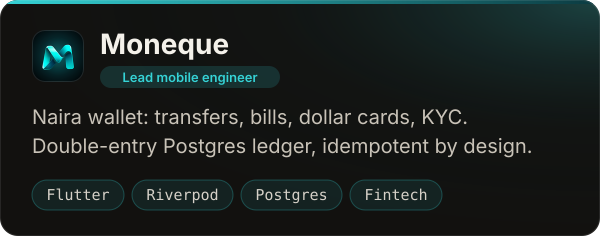
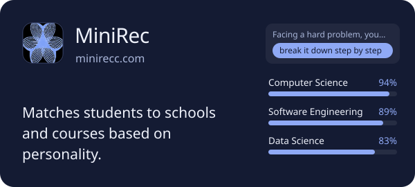
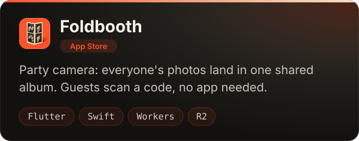
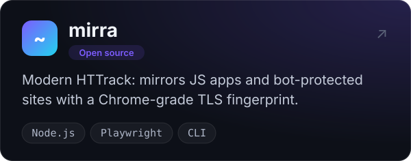
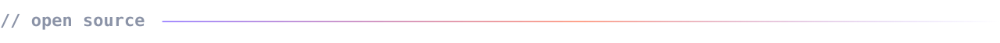
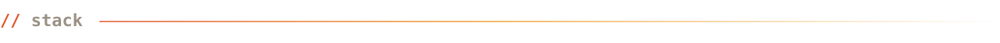
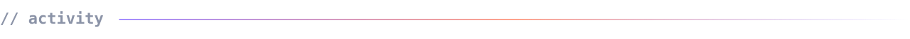

  
  
  
  

I've been writing software for 7+ years, mostly mobile apps and the backends behind them. On most products I own the whole thing: the API, the database, payments, the app itself and the App Store release. I lead mobile at **Moneque** and run **ACARSON LLC**, a small US company that ships my own products.

 

<table>
  <tr>
    <td width="50%"></td>
    <td width="50%"></td>
  </tr>
  <tr>
    <td width="50%"></td>
    <td width="50%"></td>
  </tr>
  <tr>
    <td width="50%"></td>
    <td width="50%"></td>
  </tr>
</table>

- **[mirra](https://github.com/acarsondave/mirra)**: download a website for offline browsing, including JavaScript apps and sites behind Cloudflare.
- **[appstore-checklist](https://github.com/acarsondave/appstore-checklist)**: what I check before every App Review submission, learned from real rejections.
- **[daily-fret](https://github.com/acarsondave/daily-fret)**: a guitar practice tracker.

   
  

  
  

Most of my work lives in private repos, so the graph below is busier than the public repo list.

<picture>
  <source media="(prefers-color-scheme: dark)" srcset="https://raw.githubusercontent.com/acarsondave/acarsondave/output/github-snake-dark.svg" />
  
</picture>
